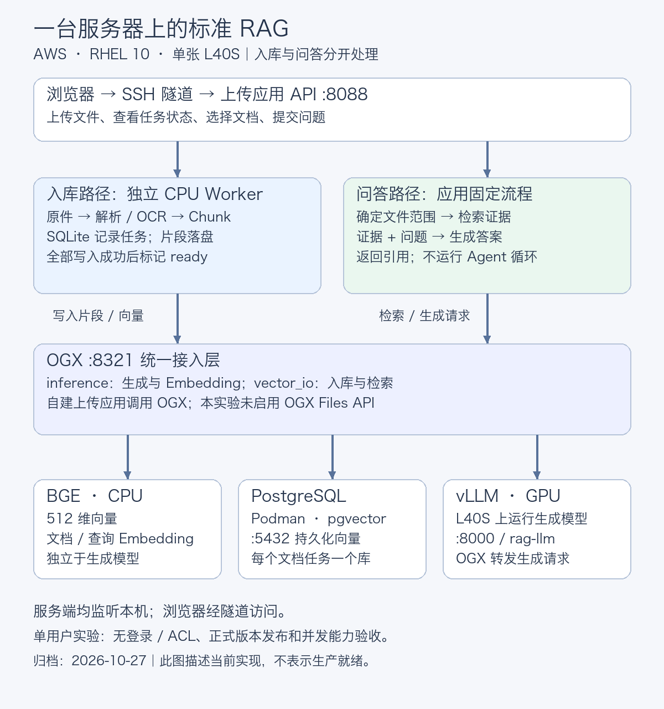
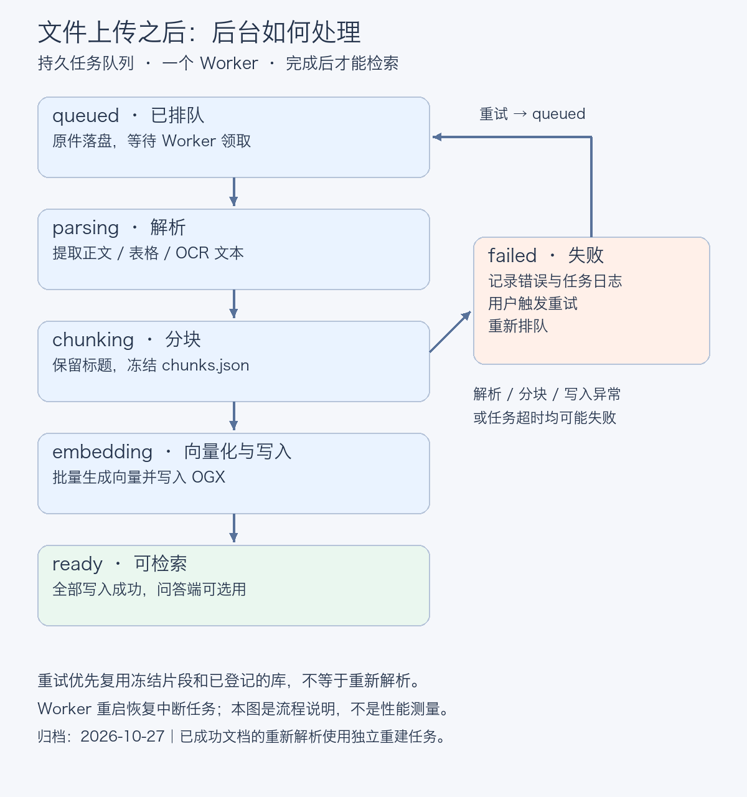

# 一台 L40S 搭建标准 RAG 从部署配置到文件问答

> **导语**
>
> 「电脑用了三年，能申请换新吗？」这个问题本身不难，难的是模型手上有没有这一份制度。
>
> 这次实验把本地模型、OGX、向量数据库和文件上传串了起来：用户上传文件，后台解析并入库，提问时返回答案和原文依据。
>
> 本文把架构、部署命令、关键配置、启动脚本和验收放在同一条路径里。目标是 AWS 上一台 RHEL 10、单张 L40S 的单用户实验。已有环境跑通了下文案例；整理后的安装模板尚未在全新主机整套重跑，不能当作一键安装保证。

> **本文结构** 架构与准备 → vLLM → pgvector → OGX → 上传与后台处理 → 文件验收 → 分块与版本 → 排障与归档

|你的环境|从哪里开始|
|---|---|
|新主机|先完成第二节基础准备，再按第三至第七节部署和验收|
|已有可用服务|直接从第七节验收开始，不重复初始化数据库或覆盖配置|

## 一、先明确每一层负责什么

**结论：vLLM、OGX、上传应用各管一段，职责不清楚，出问题时就没有排查顺序。**

vLLM 只做一件事——运行生成模型。它在 8000 端口提供接口，对外别名 `rag-llm`。OGX 负责把模型和检索能力接在一起：生成请求转给 vLLM，需要向量时调 CPU 上的 BGE，需要存取片段时找 pgvector。上传应用是这次自建的，负责文件与问答流程。

环境是一张 NVIDIA L40S，显存约 46,068 MiB。生成模型按实验约定用 `Qwen/Qwen3.5-9B`——**这个权重的具体 revision 尚未收集到本次归档，复现时需要补齐**。生成服务跑在 GPU 上，文档解析、OCR 与 Embedding 都在 CPU。



*图1：所有服务都在同一台服务器。浏览器经 SSH 隧道访问上传应用；文档入库和问答是两条不同的处理路径。*

三个独立 Python 虚拟环境的作用是隔离依赖：生成服务需要 CUDA 版 PyTorch，文档处理用 CPU 版即可，OGX 还有自己的 provider 依赖。隔开之后，调整解析器不必连带改动推理服务。

这里有一处容易误会：**上传与后台处理是这次自建的应用，并没有启用 OGX 的 Files API。** 实现参考了 Red Hat AI Quickstarts 的 RAG 项目，但没有原样部署它的 Compose 和前端，而是按这台单机的条件重新组织。

### 先拿到代码，再执行命令

本文代码与配置发布在 [ian-research/ogx-rag-lab](https://github.com/ian-research/ogx-rag-lab)，采用 Apache-2.0 许可证。第二节安装 Git 后克隆仓库即可获得完整应用，无需单独下载 ZIP。模型权重和数据库数据需要自行准备。

下文服务器命令在 **root 的 Bash** 中执行，沿用实验路径。仅 SSH 隧道命令在个人电脑执行。已有可用服务从验收部分开始，不重复初始化数据库、不覆盖现有配置。

```bash
sudo -i
bash
```

这套部署有三个运行环境和四个监听端口：

|组件|环境或运行方式|本机端口|作用|
|---|---|---|---|
|vLLM|.venv-vllm，GPU|8000|生成回答|
|PostgreSQL / pgvector|Podman，持久卷|5432|保存与检索向量|
|OGX|.venv-ogx，CPU Embedding|8321|接入生成、Embedding 和检索|
|上传 API / Worker|.venv-ingest，CPU|8088（API）|上传、后台入库、网页问答|


## 二、准备系统与目录

**结论：先确认驱动可用，再安装应用依赖，不要为复现文章反复更换已正常工作的驱动。**

服务器应能访问系统软件源、PyPI、模型下载站点、容器镜像源；首次 PDF 解析还会下载解析/OCR 模型。EC2 实例类型、CPU/内存、系统盘大小和完整包清单未在本次输出中固定，不能声称相同 GPU 就能逐字复现全部环境。

### 驱动验收，避免重复改动

```bash
cat /etc/os-release
uname -r
nvidia-smi
```

预期：RHEL 10，GPU 为 NVIDIA L40S，`nvidia-smi` 正常返回。实际记录：驱动 610.43.02、显存 46068 MiB、CUDA UMD 13.3。这不是要求所有读者必须升级到该驱动，也不是 CUDA Toolkit 安装证明。

历史驱动脚本不随本仓库发布，仅保留问题说明。它仍有以下问题，不应作为新机无条件一键安装器：

- Python 包名沿用了 `python3.12-pip/python3.12-devel`；RHEL 10 官方包名是 `python3-pip/python3-devel`。
- 提示文字写 CUDA 13.1，下载地址实际是 13.3.1。
- 下载 URL、内核模块构建依赖和软件源依赖未形成完整锁定记录；重复运行 `rpm -i` 不保证幂等。
- 同时安装 CUDA Toolkit 和 NVIDIA Container Toolkit；本实验的 pip vLLM 推理、CPU 文档服务、无 GPU 的数据库容器并不都需要这些组件。
- 去掉了强制 `NVreg_EnableGpuFirmware=0`，保留 `cuda-drivers` 路线；不添加开放驱动包替代原选择。

新主机先按 [NVIDIA RHEL 驱动指南](https://docs.nvidia.com/datacenter/tesla/driver-installation-guide/red-hat-enterprise-linux.html)核对当前镜像的内核、软件源与所选驱动包，再安装。AWS 镜像的软件源可能通过 RHUI 提供，不应照抄另一订阅环境的仓库启用命令。本仓库不自动更换已工作的驱动。

### Python 与目录

以下为整理后的 RHEL 10 参考命令：

```bash
sudo dnf install -y python3 python3-pip python3-devel git podman
python3 --version
mkdir -p /root/rag-lab/models /root/rag-lab/database /root/rag-lab/ogx/data
```

预期：Python 3.12（若镜像不同，先核对）；目录创建成功。RHEL 包名参考：[RHEL 10 包变更](https://docs.redhat.com/en/documentation/red_hat_enterprise_linux/10/html/considerations_in_adopting_rhel_10/changes-to-packages)。

在服务器克隆仓库并记录提交版本。若 `/root/rag-lab/ogx-rag-lab` 已存在，先核对内容，不覆盖或重置已有改动。

```bash
cd /root/rag-lab
git clone https://github.com/ian-research/ogx-rag-lab.git
git -C /root/rag-lab/ogx-rag-lab rev-parse HEAD
```

后续复现实验时使用记录的 commit，避免将不同版本的代码当作同一基线。

三个运行环境分别为 `.venv-vllm`（GPU 生成）、`.venv-ogx`（OGX 与 CPU Embedding）、`.venv-ingest`（CPU 解析/API/Worker）；新机下载示例另建 `.venv-download` 工具环境。不要把所有 requirements 装入同一个环境。

## 三、先让 vLLM 独立回答

**结论：先证明生成服务可用，后面的路由与检索问题才有排查起点。**

### 安装与版本检查

```bash
cd /root/rag-lab
python3 -m venv .venv-vllm
.venv-vllm/bin/python -m pip install --upgrade pip
.venv-vllm/bin/python -m pip install 'vllm==0.32.0'
.venv-vllm/bin/python -m pip check
.venv-vllm/bin/python -c 'import vllm,torch; print(vllm.__version__,torch.__version__,torch.version.cuda); print(torch.cuda.is_available())'
```

预期：依赖检查通过，CUDA 可用。实测环境输出 `0.32.0 / 2.13.0+cu130 / 13.0`。上面的顶层版本约束不等于完整依赖锁；重新解析依赖若得到不同 PyTorch 版本，应先核对 wheel 与驱动兼容性，不要把不同环境当作相同基线。

### 模型文件与启动

实验约定生成基线为 `Qwen/Qwen3.5-9B`，对外别名 `rag-llm`。本阶段没有收集到服务器上的模型 revision 哈希和完整启动命令导出，因此仓库不能证明权重逐字一致。启动前用现有模型目录和下载记录核对，不因资料归档重新下载或换模型。

若在新机下载，先把具体提交哈希写入自己的版本记录；不要把 `main` 当成固定版本。模型权重不包含在仓库内。以下只用于没有模型的新环境，哈希从模型仓库或原服务器下载记录取得：

```bash
python3 -m venv /root/rag-lab/.venv-download
/root/rag-lab/.venv-download/bin/python -m pip install huggingface_hub
# 输入模型仓库中核对过的完整 commit 哈希，不使用 main。
read -r -p '生成模型 commit 哈希: ' LLM_REVISION
read -r -p 'BGE commit 哈希: ' BGE_REVISION
[[ "$LLM_REVISION" =~ ^[0-9a-fA-F]{40}$ && "$BGE_REVISION" =~ ^[0-9a-fA-F]{40}$ ]] || { echo '需要两个完整的 commit 哈希'; exit 1; }
export LLM_REVISION BGE_REVISION
/root/rag-lab/.venv-download/bin/hf download Qwen/Qwen3.5-9B \
  --revision "$LLM_REVISION" --local-dir /root/rag-lab/models/Qwen3.5-9B
/root/rag-lab/.venv-download/bin/hf download BAAI/bge-small-zh-v1.5 \
  --revision "$BGE_REVISION" --local-dir /root/rag-lab/models/bge-small-zh-v1.5
printf '%s\n' "$LLM_REVISION" > /root/rag-lab/models/llm-revision.txt
printf '%s\n' "$BGE_REVISION" > /root/rag-lab/models/bge-revision.txt
```

预期：权重与 tokenizer 下载完成，保存实际哈希。下载工具环境与推理环境分开。本组为新机参考命令，没有在本次归档中实际重新下载模型。

```bash
export MODEL_PATH=/root/rag-lab/models/你的实际生成模型目录
bash /root/rag-lab/ogx-rag-lab/scripts/start-vllm.sh
```

预期：模型加载完毕，监听 `127.0.0.1:8000`。模板使用 BF16、8192 上下文、最多 1 个序列、显存预算 0.8，并按本次纯文本任务启用 `--language-model-only`；这些是整理后的保守启动参数，不是并发能力测试结果。若现有服务已在运行，不再启动第二个。

另开终端：

```bash
curl --fail-with-body -sS http://127.0.0.1:8000/v1/models
```

预期：模型列表包含 `rag-llm`。仅端口开放不代表模型质量验收，后面还有生成请求检查。

### 启动脚本的完整内容

`仓库/scripts/start-vllm.sh`：

```bash
#!/usr/bin/env bash
# 整理后的参考启动入口；未在全新 RHEL 主机重跑。模型目录由调用方指定。
set -euo pipefail
: "${MODEL_PATH:?请设置已有的生成模型绝对目录 MODEL_PATH}"
[[ "$MODEL_PATH" = /* && -d "$MODEL_PATH" ]] || { echo 'MODEL_PATH 必须是存在的绝对目录' >&2; exit 1; }
exec /root/rag-lab/.venv-vllm/bin/vllm serve "$MODEL_PATH" \
  --host 127.0.0.1 --port 8000 --served-model-name rag-llm \
  --dtype bfloat16 --max-model-len 8192 --max-num-seqs 1 \
  --gpu-memory-utilization 0.8 --language-model-only
```


## 四、建立 PostgreSQL 与 pgvector

**结论：数据库健康、应用账号登录和向量运算都通过，再交给 OGX 使用。**

### 已有数据库：只验收

```bash
podman ps --filter name=rag-postgres
podman exec rag-postgres psql -U postgres -d rag -v ON_ERROR_STOP=1 \
  -c "SELECT extname,extversion FROM pg_extension WHERE extname='vector';"
```

预期：容器 healthy，端口映射 `127.0.0.1:5432`，本次扩展版本 `0.8.7`。`/root/rag-lab/database/image.lock` 是本机锁定的镜像摘要；优先保存它，而非重新解析标签覆盖。

### 新环境参考步骤：只执行一次

以下会创建新容器与数据库，已有环境跳过。不删除既有容器或卷，不覆盖既有 `image.lock`。

```bash
cd /root/rag-lab/database
# 先确认没有同名容器、既有数据卷与锁文件。
podman container exists rag-postgres
podman volume exists rag-pgdata
ls image.lock
```

预期：对真正的新环境，以上对象不存在；命令返回非零是检查结果。如果已有任意对象，先核对用途，不继续初始化。

```bash
podman pull docker.io/pgvector/pgvector:0.8.7-pg16-bookworm
podman image inspect docker.io/pgvector/pgvector:0.8.7-pg16-bookworm \
  --format '{{index .RepoDigests 0}}' > image.lock
read -r -s -p '设置新数据库 postgres 管理密码: ' POSTGRES_PASSWORD
printf '\n'
export POSTGRES_PASSWORD
podman run -d --name rag-postgres \
  -p 127.0.0.1:5432:5432 \
  -e POSTGRES_DB=rag -e POSTGRES_PASSWORD \
  -v rag-pgdata:/var/lib/postgresql/data \
  --health-cmd='pg_isready -U postgres -d rag' \
  --health-interval=10s --health-retries=6 \
  "$(cat image.lock)"
unset POSTGRES_PASSWORD
```

预期：首次初始化后容器 healthy；`image.lock` 包含 `@sha256:`。这是新机参考模板，刚解析出的摘要不保证与原实验摘要一致。环境变量方式适合当前实验，容器管理员能查看配置；生产场景需另做凭据管理。

进入交互 SQL：

```bash
podman exec -it rag-postgres psql -U postgres -d rag -v ON_ERROR_STOP=1
```

仅首次建立角色时执行：

```sql
CREATE EXTENSION IF NOT EXISTS vector;
CREATE ROLE rag_app LOGIN;
\password rag_app
ALTER DATABASE rag OWNER TO rag_app;
GRANT USAGE, CREATE ON SCHEMA public TO rag_app;
SELECT extname, extversion FROM pg_extension WHERE extname='vector';
\q
```

预期：扩展和角色建立，交互设置密码。这里给 `rag_app` 数据库所有权是单用户实验简化，不是最小权限生产模板。重复执行 `CREATE ROLE` 会报已存在，不应靠删角色解决。

TCP 身份验证与向量运算：

```bash
podman run --rm -it --network host "$(cat /root/rag-lab/database/image.lock)" \
  psql -h 127.0.0.1 -p 5432 -U rag_app -d rag -W
```

```sql
SELECT current_user,current_database();
SELECT '[1,2,3]'::vector <-> '[1,2,4]'::vector AS distance;
\q
```

预期：`rag_app / rag`；距离为 `1`。本文没有配置数据库自动启动单元；主机重启后先检查/启动容器，再启动 OGX。

## 五、用 OGX 把模型与检索接起来

**结论：模型在 vLLM 中叫 `rag-llm`，经 OGX 调用时使用注册全名 `local-vllm/rag-llm`。**

### 环境和依赖

以下是按当时 provider 依赖整理的安装入口，完整可复现锁文件仍需从已运行服务器导出。已有正常 `.venv-ogx` 不重新安装。

```bash
cd /root/rag-lab
python3 -m venv .venv-ogx
.venv-ogx/bin/python -m pip install --upgrade pip
.venv-ogx/bin/python -m pip install torch torchvision --index-url https://download.pytorch.org/whl/cpu
.venv-ogx/bin/python -m pip install 'ogx==1.5.0' 'ogx-api==1.5.0' \
  'sentence-transformers>=6' 'torchao>=0.12' einops safetensors \
  'pgvector==0.5.1' 'asyncpg==0.32.0' chardet 'pypdf>=6.16.2'
.venv-ogx/bin/python -m pip check
```

预期：依赖完整、没有冲突。范围依赖不是冻结锁；如果安装器替换了 CPU torch 或发现冲突，应停止并核对依赖解析。本次曾因缺少 `pgvector` 无法启动，不能只检查 `import ogx`。

BGE 文件需要已存在 `/root/rag-lab/models/bge-small-zh-v1.5`，包含模型与 tokenizer 配置。检查：

```bash
/root/rag-lab/.venv-ogx/bin/python - <<'PY'
from sentence_transformers import SentenceTransformer
m = SentenceTransformer('/root/rag-lab/models/bge-small-zh-v1.5', device='cpu', trust_remote_code=False)
x = m.encode(['员工电脑使用满4年可以申请换新。'], normalize_embeddings=True)
print(m.device, m.max_seq_length, x.shape)
assert x.shape == (1,512)
PY
```

预期：`cpu 512 (1, 512)`。日志里的 torchao 扩展警告不自动等于失败；以模型加载、实际计算和最终异常为准。本次 CPU 测试在警告后正常通过，但其他错误仍需具体排查。

### 配置与启动

下面是 `仓库/configs/ogx.yaml` 的完整内容。`local-vllm` 指向生成服务，`cpu-embedding` 加载本地 BGE，`local-pgvector` 连接数据库；两份 SQLite 保存 OGX 自身状态。

```yaml
# 根据本次已跑通配置整理的参考文件；不是服务器配置的逐字导出。
version: 2
distro_name: rag-lab
apis:
  - inference
  - vector_io
providers:
  inference:
    - provider_id: local-vllm
      provider_type: remote::vllm
      config:
        base_url: http://127.0.0.1:8000/v1
        max_tokens: 1024
    - provider_id: cpu-embedding
      provider_type: inline::sentence-transformers
      config:
        trust_remote_code: false
  vector_io:
    - provider_id: local-pgvector
      provider_type: remote::pgvector
      config:
        host: 127.0.0.1
        port: 5432
        db: rag
        user: rag_app
        password: ${env.PGVECTOR_PASSWORD}
        distance_metric: COSINE
        persistence:
          backend: kv_default
          namespace: vector_io::pgvector
storage:
  backends:
    kv_default:
      type: kv_sqlite
      db_path: /root/rag-lab/ogx/data/kvstore.db
    sql_default:
      type: sql_sqlite
      db_path: /root/rag-lab/ogx/data/sql_store.db
  stores:
    metadata:
      namespace: registry
      backend: kv_default
    inference:
      table_name: inference_store
      backend: sql_default
registered_resources:
  models:
    - model_id: rag-llm
      provider_id: local-vllm
      provider_model_id: rag-llm
      model_type: llm
      metadata: {}
    - model_id: bge-small-zh
      provider_id: cpu-embedding
      provider_model_id: /root/rag-lab/models/bge-small-zh-v1.5
      model_type: embedding
      metadata:
        embedding_dimension: 512
server:
  host: 127.0.0.1
  port: 8321
  insecure: true
```


新环境使用 `configs/ogx.yaml`，它是根据已跑通设置整理的参考文件。已有环境先比较，不覆盖注册信息和数据库路径。

```bash
# 仅首次创建目标配置；若已存在，这条命令会拒绝覆盖。
( set -C; cat /root/rag-lab/ogx-rag-lab/configs/ogx.yaml > /root/rag-lab/ogx/config.yaml )
bash /root/rag-lab/ogx-rag-lab/scripts/start-ogx.sh
```

预期：输入 `rag_app` 密码，OGX 启动并监听本机 8321；另开终端读取模型列表：

```bash
curl --fail-with-body -sS http://127.0.0.1:8321/v1/models | python3 -m json.tool
```

预期至少包含 `local-vllm/rag-llm`、`cpu-embedding/bge-small-zh`。列表可能还有 provider 注册的其他资源，不能把“注册”写成“模型都已加载”。

数据库密码通过 `${env.PGVECTOR_PASSWORD}` 读取。启动日志若展开配置可能包含密码，不要直接贴全文或放进公开仓库。

### OGX 启动脚本

`仓库/scripts/start-ogx.sh` 的完整内容如下。它将 Embedding 限制在 CPU，数据库密码在启动时输入。

```bash
#!/usr/bin/env bash
# 不把数据库密码写入配置文件。与已运行的 OGX 二选一启动，避免端口冲突。
set -euo pipefail
CONFIG_PATH="${1:-/root/rag-lab/ogx/config.yaml}"
[[ -f "$CONFIG_PATH" ]] || { echo "配置文件不存在: $CONFIG_PATH" >&2; exit 1; }
if [[ -z "${PGVECTOR_PASSWORD:-}" ]]; then
  read -r -s -p '请输入 rag_app 数据库密码: ' PGVECTOR_PASSWORD
  echo
fi
[[ -n "$PGVECTOR_PASSWORD" ]] || { echo '密码不能为空' >&2; exit 1; }
export PGVECTOR_PASSWORD
export CUDA_VISIBLE_DEVICES=""
mkdir -p /root/rag-lab/ogx/data
exec /root/rag-lab/.venv-ogx/bin/ogx run "$CONFIG_PATH"
```


## 六、接入文件上传和后台 Worker

**结论：文件落盘只说明上传成功，整份文档完成入库，问答端才会用它。**

否则用户可能在文档只处理了一半时，得到一个看起来很完整的回答。

这一版是独立 API 加单个后台 Worker。浏览器传完文件，API 存原件、建任务，Worker 领走任务，依次解析、分块、向量化。



*图2：上传返回任务，后台完成处理；失败重试会复用已经生成的片段。重新解析是另一项操作。*

Worker 不依赖浏览器是否保持打开。任务状态写进 SQLite，解析与分块结果落成文件，中断或失败重试时可以复用已经冻结的片段。每个上传任务使用独立向量库，全部片段写入成功才标记 `ready`。

这样做的好处是过程可观察——原件、解析结果、最终被检索到的片段都能看。代价是它目前只跑一个 Worker，**不是能承载大规模并发入库的任务平台。**

不同格式走的路径不一样：Markdown 和 TXT 按标题、空行组织；DOCX 按正文和表格顺序读取，章节标题带进正文上下文，表格按行保留列名；PDF 的文字页交给 Docling，文字层太少的页面转 RapidOCR，尽量保留页码。

旧 `.doc` 需要另外用 LibreOffice 转换，这条路径本次没有验收完。DOCX 里的图片也没有接 OCR。扫描 PDF 能进入 OCR 路径，但**这不等于所有扫描件、复杂表格和图文混排都能准确还原**——数字、金额和表格建议抽检。

部署上传服务时还出现 `203/EXEC`，8088 端口没有监听。最终把 systemd 的启动方式改为虚拟环境里的 `python -m uvicorn` 后恢复。日志只能说明原启动方式执行失败，**没有足够证据把根因写死为 SELinux**，也没有把关闭安全机制作为解决步骤。

### 放置代码

使用第二节已克隆的仓库，将上传应用放到服务使用的目录。已有应用跳过复制步骤，保留 `data/`。

```bash
# 仅新部署执行；目标目录存在时停止，不合并覆盖历史数据。
test ! -e /root/rag-lab/rag-upload-lab || { echo '目标已存在，请先核对与备份'; exit 1; }
cp -a /root/rag-lab/ogx-rag-lab/rag-upload-lab /root/rag-lab/rag-upload-lab
cd /root/rag-lab/rag-upload-lab
bash install.sh
```

预期：建立独立 `.venv-ingest`，安装 CPU torch/torchvision，生成 `cpu-runtime.constraints`，安装固定顶层解析依赖，执行 `pip check` 与环境检查，并保存 `requirements.installed.lock`。CPU torch 的首次解析仍会随时间变化，生成的锁文件需留档，不能只留 requirements.txt。

首次文字 PDF/扫描 PDF 处理需要额外模型下载时间。旧 DOC 转换需要系统安装 LibreOffice，本次未验收，优先转换成 DOCX。

### systemd 启动

```bash
cp deploy/rag-upload-api.service deploy/rag-upload-worker.service /etc/systemd/system/
systemctl daemon-reload
systemctl enable --now rag-upload-api rag-upload-worker
systemctl status rag-upload-api rag-upload-worker --no-pager
curl --fail-with-body -sS http://127.0.0.1:8088/api/health
```

预期：两个服务 active，健康接口 `api=ok` 且 `worker_alive=true`。服务刚启动时可能要等 Worker 初始化，不能以建立 enable 链接代替服务健康检查。

unit 沿用 root 实验路径，API 使用 `python -m uvicorn`。它们的启用并不意味着 vLLM、OGX、数据库也受同一套 systemd 依赖管理；本次只完成了上传 API 与 Worker 的 service 管理。

已有服务更新 unit 后需要明确重启才加载新配置；已有环境应在维护窗口内操作。

### 本地浏览器访问

在个人电脑运行（使用自己的 SSH 配置）：

```bash
ssh -N -L 8088:127.0.0.1:8088 你的EC2主机别名
```

预期：SSH 保持运行，本地浏览器访问 `http://127.0.0.1:8088`。服务无登录/ACL，避免直接映射到公网。

### 安装脚本做了什么

`rag-upload-lab/install.sh` 的完整内容：

```bash
#!/usr/bin/env bash
set -euo pipefail
cd -- "$(dirname -- "${BASH_SOURCE[0]}")"
INGEST_VENV=/root/rag-lab/.venv-ingest
if [[ ! -x "$INGEST_VENV/bin/python" ]]; then
  python3 -m venv "$INGEST_VENV"
fi
"$INGEST_VENV/bin/python" -c 'import sys; assert sys.version_info >= (3,12), "需要 Python 3.12+"'
"$INGEST_VENV/bin/python" -m pip install --upgrade pip
# 先安装 CPU torch，再用精确约束防止后续解析依赖换成 CUDA 版本。
"$INGEST_VENV/bin/python" -m pip install torch torchvision --index-url https://download.pytorch.org/whl/cpu
"$INGEST_VENV/bin/python" - <<'PY' > cpu-runtime.constraints
from importlib.metadata import version
import torch
assert torch.version.cuda is None, '此独立虚拟环境需要 CPU 版 PyTorch'
for name in ('torch', 'torchvision'):
    print(f'{name}=={version(name)}')
PY
"$INGEST_VENV/bin/python" -m pip install -c cpu-runtime.constraints -r requirements.txt
"$INGEST_VENV/bin/python" -m pip check
"$INGEST_VENV/bin/python" -m pip freeze > requirements.installed.lock
"$INGEST_VENV/bin/python" check_environment.py
```

### 两个 systemd 服务的完整配置

`deploy/rag-upload-api.service`：

```ini
[Unit]
Description=RAG Upload API (lab)
After=network-online.target
Wants=network-online.target

[Service]
Type=simple
WorkingDirectory=/root/rag-lab/rag-upload-lab
Environment=PYTHONUNBUFFERED=1
ExecStart=/root/rag-lab/.venv-ingest/bin/python -m uvicorn app:app --host 127.0.0.1 --port 8088 --workers 1
Restart=on-failure
RestartSec=5
UMask=0077

[Install]
WantedBy=multi-user.target
```

`deploy/rag-upload-worker.service`：

```ini
[Unit]
Description=RAG Document Worker (lab CPU)
After=network-online.target
Wants=network-online.target

[Service]
Type=simple
WorkingDirectory=/root/rag-lab/rag-upload-lab
Environment=PYTHONUNBUFFERED=1
Environment=CUDA_VISIBLE_DEVICES=
Environment=OMP_NUM_THREADS=4
Environment=RAG_TASK_TIMEOUT=3600
ExecStart=/root/rag-lab/.venv-ingest/bin/python -u worker.py
Restart=on-failure
RestartSec=5
TimeoutStopSec=30
UMask=0077

[Install]
WantedBy=multi-user.target
```


### 改配置时，改到真正运行的进程

应用默认配置位于 `settings.py`：

```python
import os
from pathlib import Path

ROOT = Path(__file__).resolve().parent
DATA = Path(os.environ.get("RAG_DATA_DIR", ROOT / "data")).resolve()
OGX = os.environ.get("OGX_URL", "http://127.0.0.1:8321/v1")
EMBED_MODEL = os.environ.get("EMBED_MODEL", "cpu-embedding/bge-small-zh")
LLM = os.environ.get("LLM_MODEL", "local-vllm/rag-llm")
TOKENIZER = os.environ.get("TOKENIZER_PATH", "/root/rag-lab/models/bge-small-zh-v1.5")
DIM = 512
MAX_TOKENS = 384
MAX_BYTES = 50 * 1024 * 1024
SUFFIXES = {".pdf", ".md", ".txt", ".docx", ".doc"}
ACTIVE = ("parsing", "chunking", "embedding")
```

当前模型与地址无需修改。更换地址或数据目录时，可以给两个 service 添加相同的 drop-in 配置，例如运行 `systemctl edit rag-upload-api` 和 `systemctl edit rag-upload-worker`，分别写入：

```ini
[Service]
Environment=OGX_URL=http://127.0.0.1:8321/v1
Environment=EMBED_MODEL=cpu-embedding/bge-small-zh
Environment=LLM_MODEL=local-vllm/rag-llm
Environment=TOKENIZER_PATH=/root/rag-lab/models/bge-small-zh-v1.5
Environment=RAG_DATA_DIR=/root/rag-lab/rag-upload-lab/data
```

保存后，等待入库任务完成，再执行 `systemctl daemon-reload` 和 `systemctl restart rag-upload-api rag-upload-worker`。只在当前终端 `export`，不会改变已经运行的 systemd 服务。

512 维与 384 token 预算绑定当前 BGE。更换 Embedding 模型时，必须一起核对 tokenizer、维度、输入预算并重新入库，不能只改模型名后复用旧向量。

Worker 的 `RAG_TASK_TIMEOUT` 默认 3600 秒；需要强制 OCR 时，可在 Worker 的 drop-in 中设置 `Environment=RAG_PDF_FORCE_OCR=1`。这只作用于新解析，失败重试仍可能复用已冻结片段。`RAG_OCR_CACHE` 可指定 OCR 模型缓存位置。

当前上传应用的 **system prompt 在 `app.py` 的 `ask()` 中**。它要求依据检索资料回答、提供引用、资料不足时明确说明。它不是早期 `test_rag.py` 的独立提示词文件。修改后需重启 API 才会生效。


## 七、从上传到回答逐项验收

**结论：上传接口返回成功，只说明任务被接受；要看到 ready、原文片段和带来源的回答，才能确认流程完成。**

在 API、Worker、OGX、vLLM 均启动后：

```bash
python3 /root/rag-lab/ogx-rag-lab/scripts/verify-services.py
```

预期：列出模型、512 维 Embedding、模型回答和 Worker 健康。这一新增检查脚本已做语法检查，未在目标服务器运行；它不替代下面的真实入库验证。

上传示例并保存返回的 ID：

```bash
cd /root/rag-lab/rag-upload-lab
curl --fail-with-body -sS -F 'file=@examples/it-policy.md' \
  http://127.0.0.1:8088/api/documents | python3 -m json.tool --no-ensure-ascii
```

预期：返回任务 ID；HTTP 接受上传不代表 ready。随后使用真实 ID 查看状态：

```bash
DOC_ID=替换为返回的任务ID
curl --fail-with-body -sS "http://127.0.0.1:8088/api/documents/$DOC_ID" \
  | python3 -m json.tool --no-ensure-ascii
curl --fail-with-body -sS "http://127.0.0.1:8088/api/documents/$DOC_ID/chunks" \
  | python3 -m json.tool --no-ensure-ascii
```

预期：`ready`、`done=total`、`error=null`；片段能对应原件。原测试 DOCX 为 4 个片段，标题优化后本地样例为 3 个正文块；不同版本解析器或结构不能机械比较片段数。

生成请求体，先检索再问答：

```bash
python3 - "$DOC_ID" <<'PY' > /tmp/rag-question.json
import json,sys
json.dump({'question':'申请软件许可证需要谁审批？','document_ids':[sys.argv[1]]},sys.stdout,ensure_ascii=False)
PY
curl --fail-with-body -sS http://127.0.0.1:8088/api/search \
  -H 'Content-Type: application/json' --data-binary @/tmp/rag-question.json
curl --fail-with-body -sS http://127.0.0.1:8088/api/ask \
  -H 'Content-Type: application/json' --data-binary @/tmp/rag-question.json
```

预期：检索包含直属经理审批条款；回答为直属经理并引用对应编号。再测试三年/四年边界、未知报销金额、PDF 页码与自己的文件。单个问答通过不自动给出整体准确率。

**选择语义：** 前端无勾选时省略 `document_ids`，后端按文件名选创建时间最新的 ready 任务；显式 `[]` 则拒绝。单次最多 20 个文件，每库取 3 个候选，合并最终 3 个。没有重排、混合检索和概率阈值；provider 分数不是置信概率。本次配置没有显式覆盖索引参数。核对 OGX 1.5.0 源码，其默认是 HNSW（m=16、ef_construction=64、ef_search=40），距离默认 COSINE；代码包含建索引步骤。这是源码默认值证据，不是远端索引和查询计划的实际导出，也不是调优结果。需要继续验收时，可在 PostgreSQL 查询 `pg_indexes` 并检查执行计划。

### 三类问题，分别检查什么

一个回答说对了，还要检查引用是否支持结论、资料不足时是否编造。

问答流程是固定的：选定文档范围，检索片段，把证据与问题一起交给生成模型，最后返回答案和来源。提示词要求依据资料作答、标注引用编号，信息不足时明确说明缺什么。

用三类问题观察这条链路。

**事实提取。** 问「申请软件许可证需要谁审批」，Word 文件答「直属经理」并指向对应片段；英文 PDF 的同类问题也答 direct manager，并附上第 1 页来源。

**边界判断。** 问「用了三年能不能换新」，答未达四年条件；「刚好四年呢」，答可以申请。这里要区分，**「可以申请」和「必然获批」是两件事**，后者资料里没有依据。

**资料不足。** 问「换新能报销多少钱」，资料只有年限没有金额，回答明确说明未提供，没有编造数字。

这几条只能说明当前样例上的流程跑通，不能证明幻觉已被消除，也不对应某个准确率。提示词约束不能替代完整的指令注入防护，本次也没有做这项安全评测。

应用另外保留了只返回证据的 `/api/search`。回答不对时，先确认是不是检索出了问题，再判断生成环节。

## 八、分块和版本规则决定检索到什么

**结论：分块不是每隔固定字数切一刀——一段正文离开标题可能失去必要上下文，一行表格离开列名可能只剩几个无法解释的数字。**

所以这一版的顺序是先保结构、再控长度。Word 里「软件许可证」章节下的一句话，会连同标题一起进入片段；PDF 尽量记录物理页码；Word 没有固定分页信息，就展示文件名、标题和结构块位置，**不伪造页码**。

长度按实际的 BGE tokenizer 计算，带标题和特殊 token 后每段不超过 384 tokens。留这个余量，是因为这个 Embedding 模型最大输入为 512 tokens。字符数和 token 数不是一回事，中文、英文、标点都需要用实际 tokenizer 检查。

目前的规则是：每个结构块独立切片，尽量在句末或换行结束，过长再拆。没有实现片段重叠，也没有跨块合并。这是便于观察的初始基线，不是所有文件的最优解。

Word 测试里有一个很具体的问题：文档总标题「IT 政策」被单独索引进去了，甚至在检索结果里排到第二位。**这类片段信息量很低**——有标题，却没有能回答问题的正文。

修复的思路是把 Word 的 Title 样式并入后续内容的标题路径，不再单独成段。**这个修复只在本地样例和自动化测试中通过，服务器上重建后的效果还没有验收**；已入库的旧片段也不会因为修改代码而自动更新。

### 不勾选文档时，到底查哪一版

**结论：不勾选仍能回答，是本版应用定义的默认检索行为。**

规则是：不勾选时，默认查询每个文件名下创建时间最新、且已成功入库的版本；勾选则是显式限定检索范围。

这个规则解决了一部分问题。同名文件更新后，新版成功入库才替代旧版参与默认检索；新版失败时旧版继续可用；旧版一直保留，显式选择它的 ID 仍可查询旧数据。

但文件名代表不了一份制度。`制度-2025.pdf` 和 `制度-2026.pdf` 是两个不同文件名；同一份制度的 PDF 与 Word 副本也会被当成两份文档。两份内容都被检索到时，冲突就可能出现。

要进一步解决，需要稳定的文档身份、版本号、生效时间和发布状态，并在检索前决定哪些内容有效。**让模型临场判断「哪份是最新的」，替代不了这层规则。**

## 九、故障排查与重新入库

**结论：先检查证据链在哪一层中断，再调整该层配置。**

```bash
journalctl -u rag-upload-api -u rag-upload-worker -n 100 --no-pager
ss -ntlp
```

预期：服务日志可见；8000、8321、8088 和数据库 5432 的本机监听状态与对应服务一致。排查顺序是端口→服务日志→模型名→文档状态→片段内容→检索→回答。

- **API 203/EXEC：** 本次直接执行 uvicorn 入口失败，改为虚拟环境 `python -m uvicorn` 后恢复；不能据此认定是 SELinux 问题。
- **OGX 模型 404：** 先看 `/v1/models`，使用 provider 前缀全名。
- **provider 缺依赖：** 检查实际 traceback 和当前 Python 路径；不同 venv 的 pip 不能混用。
- **PDF 失败：** 查看 `data/artifacts/任务ID.log`，区分模型下载、加密/损坏文件、超时与 OCR。默认任务上限 3600 秒，单文件上限 50 MiB；不承诺解密加密 PDF。
- **文档已 ready，但片段不理想：** 重试会复用冻结片段，不会自动重新解析。Word 标题修复使用 `reindex_document.py` 创建新任务/新库；代码更新不自动修改历史向量。

已审阅代码、确认使用新解析器后，可在对应部署目录执行：

```bash
/root/rag-lab/.venv-ingest/bin/python reindex_document.py 旧文档ID
```

预期：生成或复用待处理重建任务；旧版保留，新版成功后默认检索切换。该工具本地测试通过，目标服务器重建验收尚未收到。不要把不同文件名自动归为同一制度；当前尚无正式文档身份和发布流程。

## 十、保留状态，才有下一次实验

**结论：代码包不是知识库备份，任务、原件、OGX 注册信息与数据库状态都要保留。**

保留三部分状态：上传应用 `data/`（jobs.sqlite、原件、blocks/chunks、任务日志），OGX `ogx/data/`（注册/元数据等 SQLite），以及 PostgreSQL `rag-pgdata`。仅复制脚本没有知识库，单独复制 jobs.sqlite 也没有向量。

备份要取得一致快照：暂停写入/入库任务，使用 PostgreSQL 备份工具、SQLite backup 或停服务后一致复制。不要在线只复制一个 SQLite 主文件而漏掉 WAL。本阶段没有执行恢复演练。

可选收集非敏感版本清单：

```bash
bash /root/rag-lab/ogx-rag-lab/scripts/capture-versions.sh \
  /root/rag-lab/version-record-20261027
```

预期：新目录包含系统、GPU、Python 包列表、镜像摘要和数据库版本。脚本不导出环境变量或密码，但公开前仍应人工检查。模型 revision、现有完整启动参数、生成的安装锁和镜像锁还需留档；这些缺项已写入验收记录。

### 代码入口与本阶段边界

|文件|职责|
|---|---|
|app.py|上传、文档查询/重试、原件/片段、search、ask、system prompt|
|index.html|网页上传、轮询状态、选择文档与问答|
|state.py|SQLite表、队列状态与Worker心跳|
|worker.py|单Worker进程锁、任务子进程、超时恢复、写入OGX|
|parsing.py|MD/TXT/DOCX/PDF解析、独立OCR、可选DOC转换|
|chunking.py|标题上下文与token预算、片段ID和metadata|
|settings.py|端口地址、模型ID、tokenizer路径、大小/维度限制|
|ogx_client.py|HTTP客户端和错误信息|
|reindex_document.py|重新解析既有文档，创建新任务并保留旧库|
|check_environment.py|依赖/CPU环境/tokenizer检查与可选解析诊断|
|tests/test_pipeline.py|本地单元/流程验证，OGX为模拟接口|

当前上传版本的 **system prompt 位于 `app.py` 的 `ask()`**，不是独立 `system_prompt` 文件。本仓库以当前上传应用为入口，早期 test_rag.py 和本地文件入库实验未随仓库分发。

当前仍是单用户实验：没有登录和文档 ACL，没有并发压测、正式版本发布或自动清理。后续先补文档身份与检索范围管理，再考虑重排、混合检索和权限。只有任务确实需要多步决策时，再引入 Agent。

接手这套实验时，先问三个问题：文件是否解析完整？检索证据是否支持问题？回答是否忠于证据？

### 参考与配套文件

- [Red Hat AI Quickstarts RAG](https://github.com/rh-ai-quickstart/RAG)：研究起点，本文不是其 Compose 原样部署。
- [Docling PDF/OCR 配置](https://docling-project.github.io/docling/reference/pipeline_options/)：解析选项参考。
- [完整源码与配置](https://github.com/ian-research/ogx-rag-lab)：上传应用、启动脚本、示例与测试。

本次实验记录日期为 2026 年 10 月 27 日。版本号用于说明实验基线，不代表最新版本。本仓库自建代码与文档采用 Apache-2.0 许可证。

