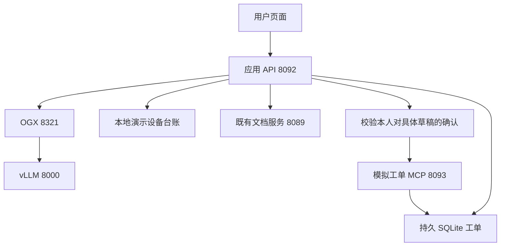

# 确认后提交换新申请

第五篇实验在已有 OGX/vLLM 与文档服务旁边增加草稿预览、页面确认和一个受控的 MCP 写入口。实际创建的是本地模拟系统中的 **待审核申请**，不判断员工已符合换新资格。

本目录使用已在 RHEL 10.2 / Python 3.12.15 上部署测试的 r4 实现。运行代码、脚本、模板、锁文件、测试和设备样例与封存版本逐字一致，映射见 [PROVENANCE.json](PROVENANCE.json)。公开部署文档另行整理。

## 服务关系

模型可通过应用内辅助工具查询设备、检索文档、记录用户理由；它拿不到写入工具。应用在用户确认后才调用 MCP 创建申请。第四篇 8090/8091 服务保留，本目录的准备草稿过程直接读设备样例、调用 8089，没有转发第四篇的只读 MCP。

## 开始使用

1. 按 [DEPLOYMENT.md](DEPLOYMENT.md) 核对前置环境、文档、独立状态目录及 systemd 配置。
2. 在服务器执行 `bash scripts/prepare.sh`，首次安装用 `bash scripts/install.sh`。
3. 通过 SSH 隧道访问页面，使用管理员单独分发的演示凭据连接。
4. 输入「我的笔记本电池鼓包，想申请更换，帮我准备申请」，预览后可修改理由、保存并重新预览，再确认提交。
5. 根据返回单号和同一提交标识回查；正常结果为 `pending_review`。

不要在开发电脑执行服务器安装脚本。完整测试方法与验证边界见 [TESTING.md](TESTING.md)。

## 本篇新增的控制

- 服务端身份绑定本人草稿，确认关联草稿 ID、版本和内容哈希。
- 在一个事务里校验确认、保存授权记录并冻结草稿。改稿后重新确认。
- 后台校验规范内容与实际字段；用提交标识的唯一约束防止同一次技术重试多建单。
- 结果未知时保持原键和冻结内容；先回查，再安全重放已授权请求。过期提交租约为 120 秒。
- 旧版本未决记录缺授权时保持冻结，等待可信回查或人工核对。
- 状态与密钥放在代码目录之外，升级不重新生成凭据。

不同草稿属于不同提交。本实验没有定义“同一员工一天只能申请一次”等业务查重政策。

## 已知体验限制

当前问题需同时包含「申请／提交／办理」之一和「换」字，才进入草稿流程；修改现有草稿理由请使用草稿下方的输入框。模型不保证每次主动检索；未取回来源时草稿明确保留缺项。

页面再次点“确认提交”会先重新请求确认，已提交草稿在该接口返回 409；页面可能显示“未完成”，但原单仍在，可按原标识回查。此界面行为与直接重放 `/submit` 的幂等验证分开看。提交后的草稿标签及取消后的按钮、输入框仍有状态刷新不足。

## 目录与许可

| 文件 / 目录 | 用途 |
|---|---|
| `action_api.py`、`web/` | 草稿、确认、提交及页面 |
| `model_loop.py`、`devices.py`、`docsearch.py` | 本地辅助工具与有界模型循环 |
| `mcp_action_server.py` | 模拟工单 MCP，含创建与只读查询 |
| `store.py`、`draft.py`、`security.py` | 持久状态、规范快照、身份与证明 |
| `deploy/`、`scripts/` | 配置模板、安装、切换、回退及测试采集 |
| `tests/`、`requirements*.lock` | 控制逻辑与协议测试、带哈希的依赖锁 |

新增实现适用仓库根目录 [Apache-2.0](../LICENSE)。上游十四条固定设备记录来自 [Red Hat IT Self Service Agent](https://github.com/rh-ai-quickstart/it-self-service-agent/tree/7fc221dc7991a3d51432af4202fff6dae94b8d93)，MIT 声明保留于 [LICENSE-UPSTREAM](LICENSE-UPSTREAM)。换新申请场景借鉴该项目；本地草稿确认、幂等写入与恢复是本实验实现，没有连接真实 ServiceNow。
