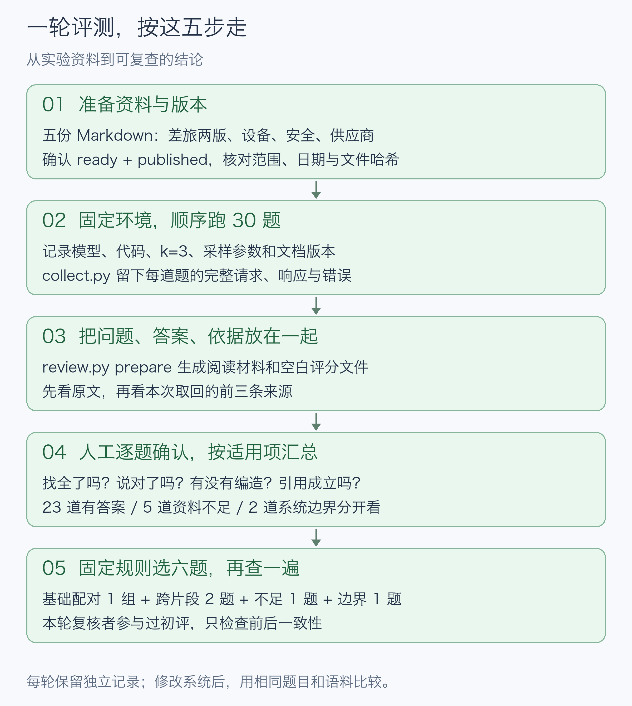
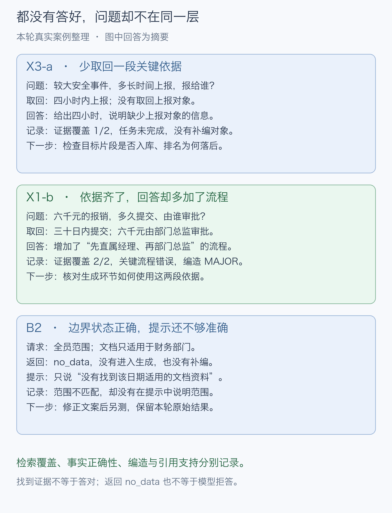

# 第三篇：给版本 RAG 加一套可重复的评测

复用第二篇的 8089 文档版本服务，顺序调用 `/api/ask`，保存完整响应，再检查版本、检索依据、答案和引用。工具不会自动把关键词命中当成回答正确，也不合成一个总分。



## 环境与文件

- 新采集：先部署 [文档版本服务](../rag-version-lab/README.md)，确认 OGX、vLLM、CPU Embedding、pgvector 和 Worker 正常。继续使用原单张 L40S，不新增模型、容器或常驻服务。
- 本目录脚本：Python 3.10+、标准库即可，无额外 pip 包；原服务器使用 Python 3.12。离线阅读、评分和汇总不需要服务器或 GPU。
- 发布整理后的命令行封装通过本地离线测试和模拟接口测试；它不等于又完成了一次服务器部署。示例里的30次完整响应来自此前实际诊断轮。
- 服务仍只监听本机。下面命令默认在服务器运行；已有环境请更新到包含本目录的仓库提交，再进入 `rag-eval-lab`。

|文件|用途|
|---|---|
|`dataset/docs/`、`dataset/questions.jsonl`|五份虚构实验文档、固定30题及逐项预期事实|
|`environment.example.json`|待填的环境记录；记录配置，不会修改配置|
|`preflight.py`|只读核对五个已发布版本、有效期和文档哈希，读取实际版本/向量库ID|
|`collect.py`|调用现有问答接口，逐题保存完整响应|
|`evaluate.py`|离线检查状态、版本标签及引用编号，语义项保留待评|
|`review.py`|生成空白评审材料、汇总已确认评分、选六题复核|
|[RUBRIC.md](RUBRIC.md)|本轮已确认的评分口径与适用范围|
|[examples/diagnostic-v3/](examples/diagnostic-v3/README.md)|实际诊断轮原始响应、初评导出、六题结论与来源说明|

## 1. 上传五份实验文档

在第二篇的 Web 页面上传下表文件；`ready` 后点击发布。全部用新文档身份，与原演示资料隔离。

|文件|文档身份 policy_id|版本|范围 scope|生效日|替代关系|
|---|---|---|---|---|---|
|eval-travel-v1.md|eval3-travel|v1|all|2026-01-01|无|
|eval-travel-v2.md|eval3-travel|v2|all|2026-06-01|替代上行v1|
|eval-device.md|eval3-device|v1|all|2026-01-01|无|
|eval-security.md|eval3-security|v1|all|2026-01-01|无|
|eval-vendor.md|eval3-vendor|v1|dept-fin|2026-01-01|无|

先发布差旅v1，再上传v2并选择v1为被替代版本。v2发布后，v1截止日应为2026-06-01；有效区间包含起日、不含止日。`all`是全员范围，不表示跨部门通配搜索。

也可用接口上传。下面是差旅v1的完整示例，返回的`version_id`用于查询状态和发布：

```bash
curl --fail-with-body -sS http://127.0.0.1:8089/api/versions \
  -F file=@dataset/docs/eval-travel-v1.md \
  -F policy_id=eval3-travel -F policy_title='实验差旅规定' \
  -F version_label=v1 -F scope=all -F valid_from=2026-01-01
```

```bash
# 换成上述响应里的实际ID；不要复制示例运行的ID。
VERSION_ID='实际返回的version_id'
curl --fail-with-body -sS "http://127.0.0.1:8089/api/versions/$VERSION_ID"
# 只有 job_status=ready 后才执行：
curl --fail-with-body -sS -X POST \
  "http://127.0.0.1:8089/api/versions/$VERSION_ID/publish"
```

其余文件按表设置。同名文档身份、范围和版本号若已存在，不要重复上传；先核对现有文件哈希和状态。文档第17条误引第18条的历史语料问题仍保留，见示例说明；修改语料应另开数据版本，不能悄悄覆盖本轮。

## 2. 记录环境并核对发布状态

```bash
cp environment.example.json environment.local.json
```

编辑 `environment.local.json`：将 `FILL_FROM_YOUR_SERVER` 替换为实际系统、驱动、服务提交、模型revision、配置哈希及记录时间。`version_id` 和 `store_id` 由下一条命令从服务读取，无须手填。可用 `git rev-parse HEAD`、`nvidia-smi`、模型目录信息及配置文件的 `sha256sum` 辅助取值；不要把示例运行记录冒充本机环境。

`documents` 已包含这五份固定原文的哈希。采样参数记录原服务的 `temperature=0.7`、`top_p=0.8`、`max_tokens=512`，检索条数 `k=3`；若你实际配置不同，请如实记录。编辑清单不会修改服务。模型和配置值仍需操作者核对，脚本不能远程证明它们真实。

```bash
python3 preflight.py \
  --environment environment.local.json \
  --docs dataset/docs \
  --output runs/preflight/environment.json
```

此命令只读版本列表，要求五份资料均为 `ready/published`，文件哈希、范围和有效期与清单一致。失败先处理具体差异；不要为了让检查通过而照抄现有错误值。输出路径必须未存在。

## 3. 运行30题，留下原始响应

```bash
python3 collect.py \
  --questions dataset/questions.jsonl \
  --manifest runs/preflight/environment.json \
  --output-root runs
```

最后一行打印新运行目录。把它赋给下方变量（须替换为实际路径）。下面的 `evaluate.py` 是可选的提前程序检查；下一步 `review.py prepare` 也会执行同一套检查，并写入 `automatic-checks.json`，不必两次都跑：

```bash
RUN='runs/实际输出的运行目录'
python3 evaluate.py \
  --questions "$RUN/questions.jsonl" \
  --results "$RUN/responses.jsonl" \
  --output "$RUN/offline-audit.json"
```

每次新采集建立独立目录，内含题库副本、环境清单、逐题请求、完整回答与来源、HTTP错误、耗时和token用量。`completed.json` 表示采集循环结束，**不表示30题都成功或答对**。遇到错误保留原记录，修复后另跑一轮；不要只替换一道失败答案。

`evaluate.py` 默认比较版本标签；只有题目提供 `expected_version_id` 时才检查实际ID，否则会显示 `NOT_CHECKED`。不能把标签相同写成完整身份校验通过。它也不检查事实语义或替人判断来源是否充分。

## 4. 生成评审材料并填写

```bash
python3 review.py prepare \
  --run "$RUN" --docs dataset/docs \
  --output-dir review-output/round-1
```

生成三份文件：

- `review.md`：每道题的预期事实、完整回答、来源编号和完整原文链接。
- `automatic-checks.json`：状态、标签、引用编号等程序结果。
- `review.json`：空白人工评分，填好后用于汇总。已有目录拒绝覆盖。

逐题按顺序核对：

1. 看原文中应有的事实，区分关键项与次要项。
2. 看本次前三条来源，逐项填写 `evidence[].covered`（`true/false`）及 `source_numbers`。一项需要两段共同支撑时填写两个编号。判断不了保留 `null`、在理由中注明，暂不做最终汇总。
3. 填写 `relevant_source_numbers`，无相关来源填 `[]`。找到相关片段与找全必需事实分开记录。
4. 填写事实正确性、编造、拒答、引用支持，以及评审人、时间、至少一句理由。全部枚举和适用范围见评分规则。

例如 X1-a 只答出了“三十日内提交”，第二问用“系统自动分派”代替了“部门总监”。应记录覆盖1/2、事实FAIL；已有两句陈述有依据，可同时记录编造NONE、引用FULL。这些字段描述不同问题，不能互相替代。

N1–N5需要核对完整原文是否确实没有答案，不能仅凭取回三段就下结论。B2/B3不进入生成，单独检查状态、固定提示是否准确、是否补编，其余项N/A。

可以让助手像本文一样逐题展示材料，由人确认或修订后记录。应如实标记为辅助交互评审，不冒称独立盲评；不知道的项先保留待复核。

## 5. 汇总已确认字段

```bash
python3 review.py summary \
  --run "$RUN" \
  --review review-output/round-1/review.json \
  --output review-output/round-1/summary.json
```

汇总会检查题库/响应哈希、题号、适用项、事实数量和来源编号。尚有 `PENDING/null`、未写理由或指向另一轮响应时会拒绝输出。`REVIEW` 是明确的待复核判断，保留独立计数，不算通过。

结果分为23道有答案、5道资料不足、2道无适用资料（使用随仓库的题库时）。同时列逐事实覆盖与配对字段差异，不计算混合总通过率。字段合法也不等于语义判断一定正确。

## 6. 选六题做二次核对

```bash
python3 review.py sample \
  --run "$RUN" \
  --output review-output/round-1/selection.json
```

配额固定为：基础配对1组2题、跨片段2题、资料不足1题、边界1题。协议名、运行目录名、题库和响应哈希组成种子，各类别按SHA256排序取配额。抽到哪组就保留哪组，不因已知问题换题。

依据 `selected_case_ids`，重新阅读对应问题、来源和回答，另存复核意见；逐字段比较事实正确性、编造、拒答和引用支持，逐项比较证据覆盖。边界题还看提示准确性。发现分歧回到原文和规则，不做分数平均；未覆盖的新规则先确认，记录是否需要全量重评。

本次六题是初评完成后才按固定算法选择，且助手已经参与初评，属于二次一致性核对。可重现选题不代表评审独立。若未来安排真正盲评，应在评审设计阶段安排独立评审人并隔离初评意见。

## 没有服务器也可先走一遍

下面只使用随仓库保存的诊断响应，**不会调用OGX或重新推理**：

```bash
python3 review.py prepare --run examples/diagnostic-v3 \
  --docs dataset/docs --output-dir review-output/example
python3 review.py summary --run examples/diagnostic-v3 \
  --review examples/diagnostic-v3/initial-review.json \
  --output review-output/example/summary.json
python3 review.py sample --run examples/diagnostic-v3 \
  --run-id 20261104T170909Z-7595b62b \
  --output review-output/example/selection.json
```

预期事实评分为PASS14/FAIL9（仅23道有答案题），事实覆盖24/41，六题为K5-a、K5-b、K4-a、X1-a、N2、B3。它们只描述这组实验数据，不能推成通用模型准确率，也不是本次发布新跑出的效果提升。

## 案例如何定位



## 测试

```bash
python3 -m unittest discover -s tests -v
```

覆盖完整响应留存、错误记录、引用编号、哈希绑定、空白材料、适用项、事实证据来源、历史计数及固定选题复现。测试使用保存响应和模拟接口，不代替新环境的真实采集。
