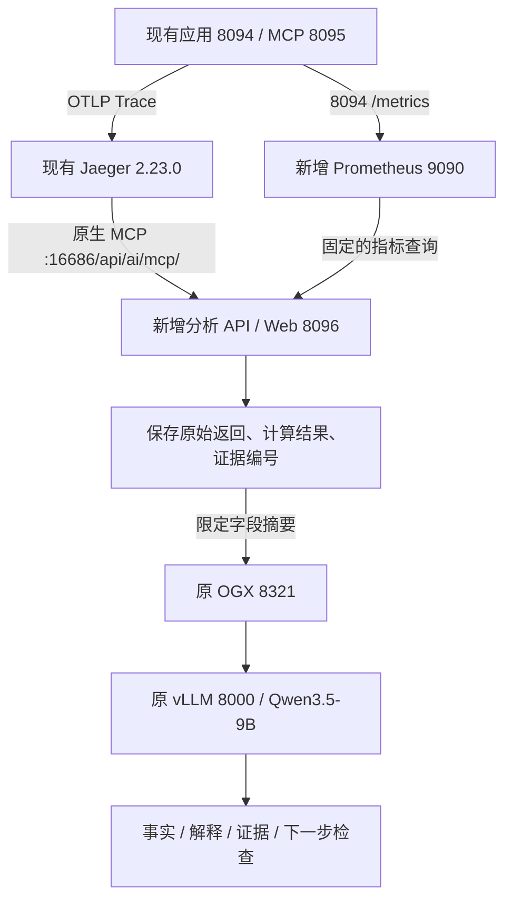

# 第七篇：让 AI 解释链路与指标

在[第六篇可观测性实验](../rag-observability-lab/README.md)上增加只读运维入口：程序从 Jaeger 原生 MCP 和 Prometheus 取数、统一单位并保存证据，再通过 OGX 调用原来的模型解释。页面同时展示模型原文、程序事实和证据来源，便于逐项核对。

新增服务使用 CPU，继续使用已有的单张 L40S、OGX、vLLM 和 Qwen3.5-9B。建议先完成第六篇，再部署本目录。

## 部署关系



MCP 工具由程序调用，模型没有工具执行或修复权限。8096 使用独立运维凭据；它不是员工申请页面，也没有接入企业 SSO。API、Prometheus 继续只监听本机，通过现有隧道访问。

| 入口 | 作用 |
|---|---|
| `http://127.0.0.1:8096/` | 运维分析页面 |
| `http://127.0.0.1:9090` | Prometheus，抓取 8094 的指标 |
| `http://127.0.0.1:16686/api/ai/mcp/` | 已有 Jaeger 原生 MCP |
| `http://127.0.0.1:8321` | 已有 OGX，模型名 `local-vllm/rag-llm` |

## 获取与首次安装

在 RHEL 服务器的 root Bash 中执行。已有仓库先保存自己的修改，再更新；不必重复克隆。

```bash
git clone https://github.com/ian-research/ogx-rag-lab.git /root/rag-lab/ogx-rag-lab
cd /root/rag-lab/ogx-rag-lab/rag-insight-lab
git rev-parse HEAD

export STATE_DIR=/root/rag-lab/article07-state
PYTHON_BIN=python3.12 bash scripts/prepare.sh
podman pull docker.io/prom/prometheus:v3.5.0
bash scripts/install07.sh

systemctl is-active article07-api article07-prometheus
curl --fail-with-body -sS http://127.0.0.1:8096/api/health
```

先确认第六篇业务 API、Jaeger MCP 和原模型可用。安装器校验固定的 x86_64 Prometheus 镜像 ID；服务启动后也使用这个 ID，避免标签变化。完整前置检查、镜像不匹配、配置、升级和回退方法见 [DEPLOYMENT.md](DEPLOYMENT.md)。

首次准备生成 `$STATE_DIR/private/credentials-for-delivery.json`（0600），将其中的运维凭据单独交给操作人，在 8096 页面连接。已有凭据不会由准备脚本覆盖。代码包不含任何实用凭据。

## 页面怎么用

1. 在第六篇 8094 业务页面发起一次查询，保留返回的 Trace ID。
2. 等待它落入封闭窗口：分析结束点为 UTC 当前时间减 45 秒后向下取整到分钟，实际滞后 45–105 秒。
3. 在 8096 选择服务、问题类型和回看分钟数，填写想了解的问题后分析。页面使用类型和窗口选择 Trace；需要精确指定 Trace 时使用下面的 API。
4. 对照“解释”“程序计算的事实”和“证据来源”。同一份证据可通过 `/api/explain` 换一个问题，原证据保持不变，每次解释另存运行记录。

| `question_type` | 适合检查 |
|---|---|
| `latency_breakdown` | 等待主要在哪个应用阶段 |
| `failure_where` | 错误 Span、HTTP 状态和工具结果 |
| `capacity_gap` | 现有证据是否足以支持容量判断 |
| `window_requests` | 两个等长窗口的计数观测增量 |

窗口计数只对应 `action-lab-api`。Prometheus 要先积累覆盖两个窗口的历史；两个五分钟窗口至少需要十分钟的有效历史，再考虑封闭窗口滞后。采样不足时看 `usable/comparable`，不要只看模型文字。

### API 示例

下面程序使用标准库，从交互输入读取运维凭据，不把凭据写进源码。它会采集一次证据并调用模型解释；先在 8094 产生可见且落入时间窗口的业务 Trace。

```bash
python3.12 - <<'PY'
import getpass
import json
import urllib.request

body = {
    "question_type": "latency_breakdown",
    "question": "这次问答主要等在模型接口，还是文档或工具查询？",
    "service": "action-lab-api",
    "window_minutes": 60,
    # "trace_id": "替换为实际的16或32位十六进制Trace编号",
}
token = getpass.getpass("运维凭据：")
request = urllib.request.Request(
    "http://127.0.0.1:8096/api/analyze",
    data=json.dumps(body, ensure_ascii=False).encode(),
    headers={"Content-Type": "application/json", "Authorization": "Bearer " + token},
    method="POST",
)
with urllib.request.urlopen(request, timeout=180) as response:
    print(json.dumps(json.load(response), ensure_ascii=False, indent=2))
PY
```

| 方法与路径 | 用途 |
|---|---|
| `GET /api/health` | 进程健康，不代表后端已联通 |
| `GET /api/whoami` | 验证运维身份 |
| `POST /api/analyze` | 采集并保存证据，调用模型解释 |
| `POST /api/explain` | 以 `{"evidence_id":"实际编号","question":"新问题"}` 复用已有证据 |
| `GET /api/evidence/{eid}` | 查看完整证据，仅运维凭据可访问 |

## 结果应该怎样理解

- `model.chat` 是客户端接口往返时间，不是 GPU 内部推理时间。`model.loop` 包含模型调用，嵌套/并行阶段不可相加。
- `HTTP 200` 不说明内部文档查询成功；`no_record/rejected` 等业务结果也不等于系统故障。
- 窗口增量是逐标签序列计算、遇计数器归零后重新累计的观测结果，不采用 `increase()` 外推，也不是逐条业务日志的精确盘点。
- 覆盖检查使用 `timestamp(counter)` 返回的真实样本时间，不把查询求值点当作新的抓取。缺失或过旧的序列会影响可比性。
- `guard=ok` 只表示结构与证据编号检查通过。它不验证数字运算、引用支持关系或因果解释。
- 24,000 字节限制针对模型所见事实摘要，不是整个请求体或所有原始工具数据的总上限。完整请求与摘要分别保存。

模型结果仍需核对。本轮一个真实案例引用了正确编号，却把 `2×15秒` 写成 `3秒`，还把 16 条序列当成 16 个路由。不要把“接口可用”当作回答准确率。

## 测试、证据和源码包

```bash
python3.12 -m venv .venv-test
.venv-test/bin/pip install --require-hashes -r requirements.lock -r requirements-test.lock
.venv-test/bin/python -m pip check
.venv-test/bin/python -m pytest tests -q

# 可选：Node.js离线页面字段检查，使用仓库内的合成fixture，不调用模型
node scripts/check_page.cjs

# 按白名单打包，默认写到 /tmp，输出SHA256
bash scripts/package07.sh /tmp/article07-source.tar.gz
```

[TESTING.md](TESTING.md)列出程序测试、真实案例和页面回放各自的范围。原始 RHEL Python 3.12.15 环境完成 42 项程序测试；正式五类案例共十问由助手逐项审阅，不是作者人工评分，也不是准确率统计。

状态目录保存 `evidence/`、`evidence-raw/`、`runs/`；用 `scripts/verify_evidence.py` 验证运行记录对应的证据。原始业务 Trace、日志、台账、凭据及模型权重不随源码发布。

## 文件与限制

| 路径 | 内容 |
|---|---|
| `insight/` | API、只读后端适配、事实计算、提示词和解释检查 |
| `web/index.html` | 独立运维分析页面 |
| `deploy/` | systemd、持久配置与 Prometheus 模板 |
| `scripts/` | 准备、安装、卸载、证据校验、离线页面检查与打包 |
| `tests/` | 模拟后端程序测试、安装器隔离测试、合成页面 fixture |
| `requirements*.lock` | 运行/测试两份带哈希依赖锁 |

systemd 单元设置开机启用；本轮没有做整机重启、压力测试或长期留存验证。Jaeger 继续使用第六篇的内存模式，重启会丢失已存 Trace；Prometheus 本实验保留一天指标。所有运维身份属于同一管理域，不提供不同管理员间的证据隔离。

代码采用 [Apache-2.0](LICENSE)。架构参考 [Red Hat AI Observability Summarizer](https://github.com/rh-ai-quickstart/ai-observability-summarizer/tree/f85933a15e5460d55f28ff05545b8b3f19fe99ce)，本目录是单机适配实现，不是完整 OpenShift 部署；没有复制上游源码。Jaeger、Prometheus、模型及 Python 依赖适用各自许可证。
